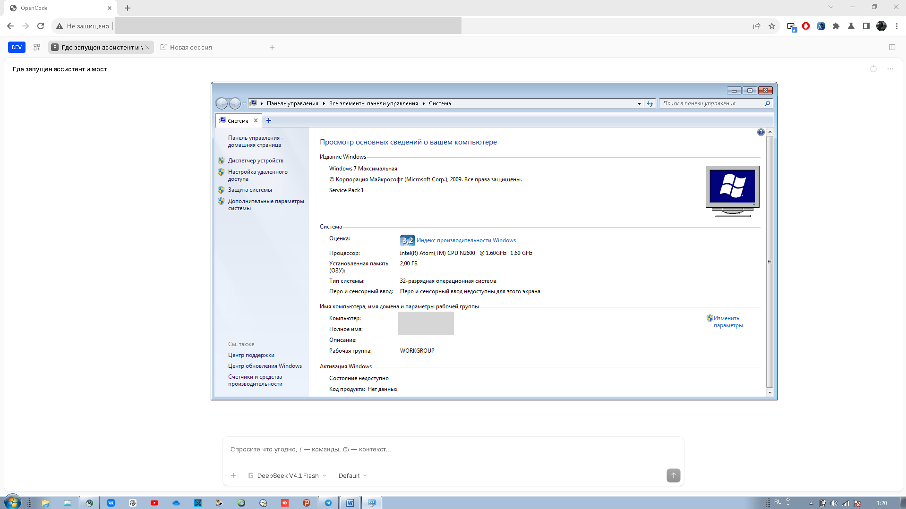
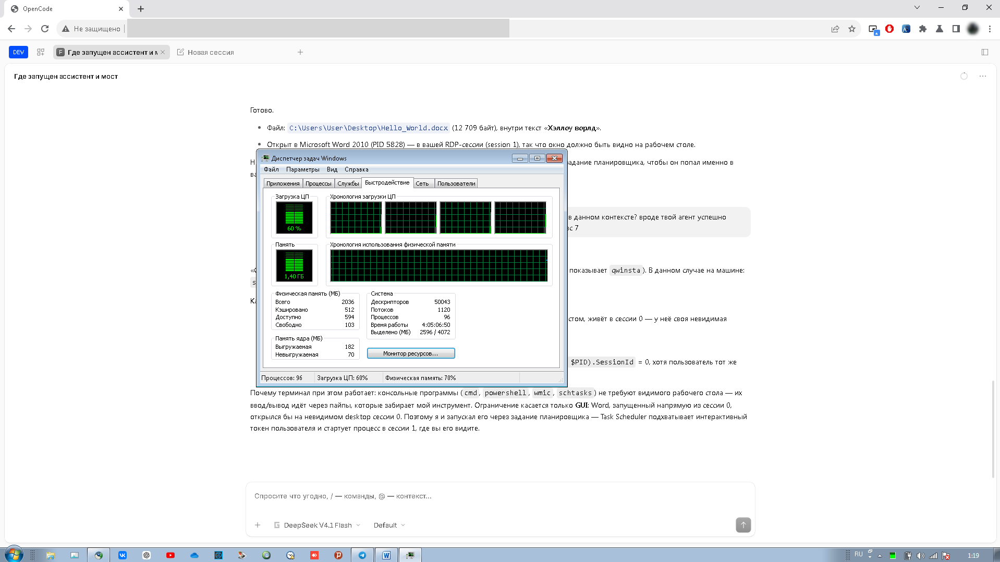
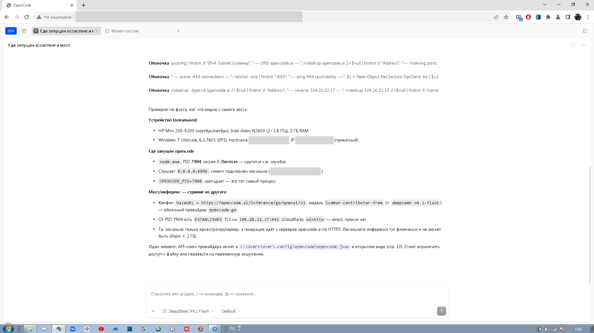
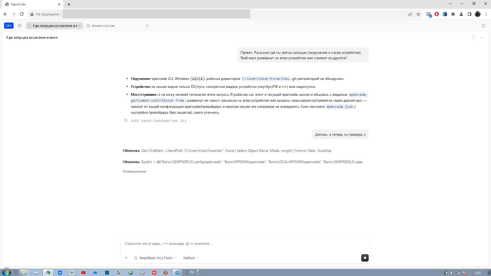

# OpenCode for Windows 7 SP1

[](https://github.com/craftinglivegames/opencode_windows7_32bit_port/releases/latest)
[](LICENSE)
[](#requirements)

**English** | [Русский](README.ru.md)

An unofficial port of [OpenCode](https://opencode.ai) (v1.19.3) to **Windows 7 SP1**.
Two independent tracks:

| Track | Status |
|---|---|
| **Native x32** — Node 22 x86 + shims, server and web UI entirely on 32-bit Win7 | ✅ **Works**, verified on a real netbook |
| **x64** — patched Bun SEA (`OCShellWin7.exe`) | ⚠️ Launcher and shims work, but the Bun runtime exits with code 3 |

> **For normal use, take the native x32 package.** It needs no second computer
> and targets 32-bit Win7; on 64-bit Windows it runs as a 32-bit app
> (WoW64, not separately tested).

---

## Download and run (x32, recommended)

**Download:** [latest release](https://github.com/craftinglivegames/opencode_windows7_32bit_port/releases/latest)
→ file **`OpenCode-Win7-x32-portable.zip`** (~54.5 MB). The archive is not stored
in git: it is built by `python tools/make_portable.py` and attached to the release.

### Requirements

| | |
|---|---|
| OS | Windows 7 SP1, **x86** (on x64 it runs as a 32-bit app via WoW64, not separately tested) |
| Updates | UCRT — KB2999226. Present on an updated Win7 SP1; without it `node.exe` will not start |
| Disk | ~200 MB free (unpacked package) |
| Port | 4096 free; the launcher stops a stale `node.exe` on that port itself |
| Rights | a regular user, no installer, no administrator rights |

### Install

There is no installer: the package is portable and writes nothing to the registry
or `Program Files`.

1. Extract the archive **completely** (do not run the exe from inside the zip)
   into a folder without spaces or non-ASCII characters, e.g. `C:\OpenCode`.
2. If Windows says "This file came from another computer" — unblock it:
   right-click `OpenCode.exe` → **Properties** → **Unblock** → OK.
   (Binaries are unsigned; SmartScreen on Win7 may complain.)
3. Run **`OpenCode.exe`**.
   - The launcher stops an old server on port 4096 (if any), starts a new one
     and opens the UI in Supermium in app mode.
   - If Supermium is not found — the default browser is used.
   - On subsequent runs it just opens the window; the server is not restarted.
4. Wait for the UI to load. If after an update you get an old page with an
   error — press **Ctrl+F5** once (browser cache reset).
5. To use it from other machines: `http://<ip-of-this-PC>:4096`
   (the server listens on `0.0.0.0`, there is no password — trusted networks only).

Fallback launch without the exe: `OpenCode.cmd` (the same via a batch file).
Headless server: `run_server.cmd`. Logs: `logs\launcher.log`, `logs\server.log`.

### Checksums

For the archive attached to the latest release (`v0.2.6-x32`):

| File | Size | SHA-256 |
|---|---|---|
| `OpenCode-Win7-x32-portable.zip` | 54 493 028 | `af28981853bd37f0f6bd946b3e0644c2b9ec5aa8a162364deb7b5f38b403dafa` |
| `OpenCode.exe` (inside the archive) | 159 232 | `bd580bc0f2a319e839e0e5d3e8f83dc6b18d13606d057dcfeaba66d3b406d1e2` |

Verify: `certutil -hashfile OpenCode-Win7-x32-portable.zip SHA256`.

### Models and keys

- Keys: `%USERPROFILE%\.local\share\opencode\auth.json`
- Config: `%USERPROFILE%\.config\opencode\opencode.json`
- To make the model list open fast, add to the config:
  ```json
  "enabled_providers": ["opencode-go", "openrouter"]
  ```
  Otherwise the server pulls the full models.dev catalogue once (7 MB, 20–40 s),
  which is why the model list could look empty.

- **Model catalogue cache.** On first start the server downloads the model list
  from models.opencode.ai (~6 MB) into `%USERPROFILE%\.cache\opencode\models.json`.
  That portal **may be unreachable** from Win7 (old TLS/root certificate, firewall) —
  then no cache is created, the server hits the network on every start and fails,
  and the model list in the UI is empty (look for `Failed to fetch models.dev`
  in `logs\server.log`).

  **Quick fix:** refresh cache and config with the script shipped in the package
  (needs only internet, uses the bundled node):

  ```bat
  C:\OpenCode\sync_free_models.cmd
  ```

  The script downloads the catalogue, updates the cache, appends live free models
  to `opencode.json` (with a `opencode.json.bak.*` backup, existing entries are
  left alone) and reminds you to restart the server.
  Source: [`tools/sync_free_models.cmd`](tools/sync_free_models.cmd) and
  [`sync_free_models.js`](tools/sync_free_models.js).

  Manually (if the script fails): download
  `https://models.opencode.ai/api.json` in a browser, put it into
  `%USERPROFILE%\.cache\opencode\models.json` and restart the server.

- **The server reads the model list once at startup.** After updating the cache
  or `opencode.json` you must restart the server (close its window and run
  `OpenCode.cmd` again) — otherwise the UI keeps showing the old list. There is
  no "refresh" button.

- Free-model details, regional blocks and the exact per-provider lists are
  described in the Russian README: [README.ru.md](README.ru.md#модели-и-ключи).

- **Free quota is per external IP until you sign in.** Anonymous requests use the
  shared public Zen key, so every device behind one NAT (home, office) shares the
  same daily quota; it resets at midnight UTC. Run `accounts.cmd` (or
  `OpenCode.exe --accounts`) for the local **Accounts & limits** page:
  sign in with a device code, add a service API key, rename/remove accounts and
  switch the active one. The panel keeps its own account list in
  `%USERPROFILE%\.local\share\opencode\port_accounts.json`; switching writes the
  chosen credential into the port database and restarts the server (opencode
  1.19.3 stores a single credential per provider and reads it at startup).
  One account on two devices still shares its quota.

---

## What has been verified

Real hardware: **HP Mini 200-4200**, Intel Atom N2600 (2×1.6 GHz), 2 GB RAM,
Windows 7 Ultimate SP1 x32.

| Check | Result |
|---|---|
| Server `/global/health` | ✅ `{"healthy":true}` |
| Web UI and assets | ✅ 200 |
| Creating a session from the UI | ✅ (after the Solid transition fix) |
| Model list in the UI | ✅ OpenCode Go + 12 free OpenRouter (10 working) |
| `opencode run` via OpenCode Go | ✅ `deepseek-v4.1-flash`, `iceman-contributor-free` |
| OpenRouter free models | ✅ 10 of 12 |
| Terminal (node-pty / winpty) | ✅ `cmd.exe`, exit 0 |
| LAN access | ✅ from a host machine |

### Screenshots

| | |
|---|---|
|  |  |
| Win7 SP1 x32, Atom N2600, 2 GB RAM | Processes and memory on the netbook |
|  |  |
| OpenCode in Supermium: environment report | A live model answer in the UI |

---

## How it works

```
node\node.exe      Node 22.23.4 x86, patched for Win7 + ocshim32/ocadv32
app\index.js       opencode 1.19.3, built with bun build --target=node
app\webui\         built-in web UI (SolidJS), served by the server
OpenCode.exe       native x86 launcher (GUI, no console)
LICENSE*.txt       port, opencode and Node.js licenses
THIRD_PARTY_NOTICES.txt  component list and changes made
```

- **Node 22 x86.** There is no official Node 22 build for Win7; the binary is patched:
  `KERNEL32!GetSystemTimePreciseAsFileTime` and `ADVAPI32!EventSetInformation`
  are redirected to shims (`ocshim32.dll`, `ocadv32.dll`). 385 static imports were
  checked in total — the rest resolve on Win7.
- **Bun → Node.** The bundle is built with `bun build --target=node`; all prod
  `Bun.*` calls are replaced with Node equivalents (33 places),
  `bun:sqlite` → `node:sqlite`, `@lydell/node-pty` → `node-pty` (winpty on Win7).
- **Launcher.** `OpenCode.exe` checks port 4096, terminates a stale `node.exe` if
  needed, starts the server hidden, waits up to 90 s and opens Supermium with
  `--app=http://127.0.0.1:4096`. Logs: `logs\launcher.log`, `logs\server.log`.

### UI fixes that make it usable

Applied to the release archive and reproducible with
`python tools/patch_release.py <package-dir>`:

1. **Project path.** For a non-git folder the server substituted the drive root
   (`C:\`) and worktree `/`; the UI requested providers for a non-existent
   directory, so the model list was empty. The real directory is used now.
2. **Solid 1.9.10 transition bug.** Memos created inside a router transition were
   read as `undefined`, so "New session" failed with
   `Cannot read properties of undefined (reading 'child' / 'directory' / 'data')`
   and later with `<X> context must be used within a context provider` covering
   half the screen while the chat below kept working. Transitions in the bundle
   now run without deferred memos and restore the Solid owner, so deferred
   renders stay inside the provider chain.
3. **Context registry safety net.** Deferred renders of lazily loaded chunks are
   a known upstream opencode bug (issues
   [#28857](https://github.com/anomalyco/opencode/issues/28857),
   [#28771](https://github.com/anomalyco/opencode/issues/28771)): some screens
   and dialogs may render outside their providers. Every context read now
   remembers the value it returned, providers additionally publish into a global
   registry, and a read that misses the local owner chain takes the last mounted
   value instead of throwing. Covered: Solid contexts, opencode's own
   `createSimpleContext` (`Settings` and friends), the router, the dialog stack
   and the TanStack query client; `useDialog` and Kobalte's internal dialog
   context no longer kill the tab.
4. **Owner capture.** `createComponent` remembered the *first* owner it ever
   saw, so a deferred render restored a context chain from outside the
   router/query providers. It now remembers the latest owner.
5. **Browser cache.** The main chunk is marked `?v=3` so old JS does not stick.

Verified on the netbook (Win7 SP1 x32, Atom N2600, 2 GB): a new session opens
from the home screen, the prompt is sent and the model answers in the UI.
Known limitation: opening the settings dialog from the home screen right after a
draft may still do nothing; reloading the page fixes it. The complete solution is
rebuilding the bundle from patched upstream sources.

---

## Build from source

You need Visual Studio (MSVC, x86), Python 3 and, to rebuild `app\index.js`,
Bun and a clone of `anomalyco/opencode` v1.19.3
(details: [`docs/BUILD.md`](docs/BUILD.md), technical report:
[`docs/spike-win7-x86/REPORT.md`](docs/spike-win7-x86/REPORT.md) — both in Russian).

```bat
:: 1. shims and patch of node.exe x86 (needs the original node.exe)
tools\build_shims_x86.cmd path\to\node.exe

:: 2. native launcher -> dist\OpenCode.exe
tools\build_launcher.cmd

:: 3. portable package -> dist\OpenCode-Win7-x32-portable.zip
python tools\make_portable.py
```

`make_portable.py` calls `tools\patch_release.py` itself and puts
`OpenCode.exe` + `OpenCode.cmd` + `run_server.cmd` + README into the archive.
All binaries are build outputs and are not committed to git.

---

## x64 track (Bun SEA) — historical

`OCShellWin7.exe` is a self-extracting launcher for Win7 SP1 x64 that patches
`opencode.exe` (Bun SEA) with the `ocshim32.dll` / `ocn.dll` shims and redraws
ANSI output in the Win7 console. Built by `tools\build_shell.cmd` (MSVC x64);
the 58 MB binary is not stored in the repository.

**Current status:** self-extraction and shims work, but Bun 1.3.14 on Win7 exits
with code 3 without output. This is a Bun limitation, not a launcher issue; the
working solution is the native x32 port above. Launcher and shim sources
(`src/`, `tools/`) are kept for history and experiments.

The 32-bit client scheme (x64 Bun server + 32-bit `OCShellClient.exe` showing the
web UI in Supermium) is legacy and no longer needed; the sources are still there
(`src/client.cpp`, `tools/build_client.cmd`).

---

## Repository layout

```
src/      C++: x32 launcher, ANSI proxy, shims, self-extract payload
tools/    build scripts (MSVC/Python), PE patcher, packaging, release patches
docs/     port description, spike report, build guide
patches/  port changes on top of upstream opencode v1.19.3 (git-apply patch)
third_party/  upstream license texts (opencode, Node.js)
.github/  issue templates
screenshots/  screenshots from the real netbook
build/    build outputs (ignored, produced by tools\build_*.cmd)
dist/     release artefacts (ignored, produced by the build scripts)
LICENSE   MIT for the port code
THIRD_PARTY_NOTICES.md  components, licenses and changes made
SECURITY.md  how to report a vulnerability, what is out of scope
CONTRIBUTING.md  build rules and what not to commit
CHANGELOG.md  release history
RELEASE.md  release publishing checklist
```

Documentation (Russian):
- [docs/PORT-native-x32.md](docs/PORT-native-x32.md) — what was done and how it was tested.
- [docs/BUILD.md](docs/BUILD.md) — the full x32 package build chain.
- [docs/spike-win7-x86/REPORT.md](docs/spike-win7-x86/REPORT.md) — technical report
  on the Bun → Node x86 migration (shims, bundle, node-pty, model matrix).
- [RELEASE.md](RELEASE.md) — release publishing checklist.
- [README.ru.md](README.ru.md) — full Russian README.

---

## License, status and credits

**Author:** Никита Шустол / Nikita Shustol — [vk.ru/nikitashustol](https://vk.ru/nikitashustol)
**Studio:** [CraftingLiveGames](https://craftinglivegames.xyz/) — the port is developed
and maintained there.

**This is an unofficial port.** It is not affiliated with, endorsed by or
supported by the OpenCode authors; the name "OpenCode" is used only to point at
the origin of the code. No trademark rights are transferred.

| What | License | Text |
|---|---|---|
| Port code (launcher, shims, build scripts, patches, docs) | MIT | [LICENSE](LICENSE) |
| OpenCode 1.19.3 — `app/index.js`, `app/webui` (modified build) | MIT, © 2025 opencode | [third_party/opencode-LICENSE.txt](third_party/opencode-LICENSE.txt) |
| Node.js 22 x86 — `node/node.exe` (patched binary) | MIT + bundled licenses | [third_party/node-LICENSE.txt](third_party/node-LICENSE.txt) |
| node-pty, `@opentui/*`, solid-js, seroval, s-js, entities, csstype | MIT / BSD-2-Clause | `LICENSE` inside each package in the archive |

MIT and BSD allow modification and redistribution but require keeping copyright
notices and the license text and clearly marking changes. That is why the release
archive ships `LICENSE.txt`, `LICENSE-opencode.txt`, `LICENSE-nodejs.txt` and
`THIRD_PARTY_NOTICES.txt` with the list of changes made by the port. Details:
[THIRD_PARTY_NOTICES.md](THIRD_PARTY_NOTICES.md).

Bun, Visual Studio and Python are build tools only and are not shipped.
We do not distribute Supermium/Chromium: if installed, the launcher just opens it
in `--app` mode; the browser has its own licenses.

Everything is provided "as is", without warranty. The server runs without a
password and listens on `0.0.0.0` — do not expose it to the internet or use it on
a machine with untrusted users.

Free opencode models are quota-limited per external IP (an office NAT shares
one quota, no login needed), reset at midnight UTC. The patched build shows
the wait time from the server's `retry-after` in the error instead of a bare
"Subscribe to Go".
