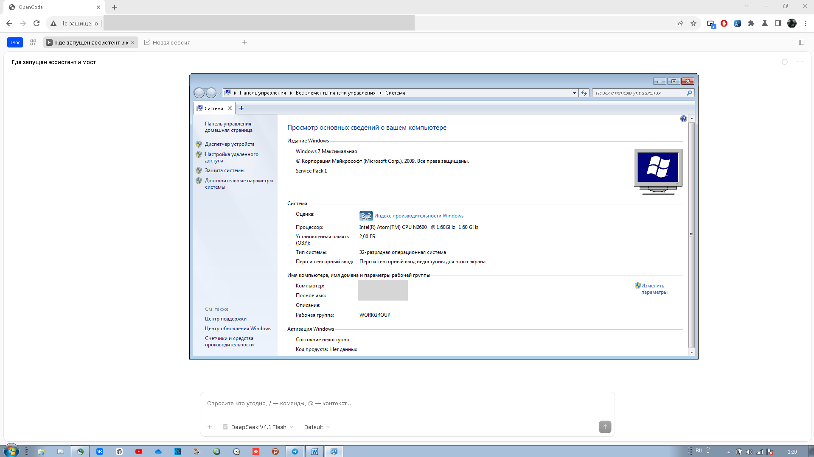
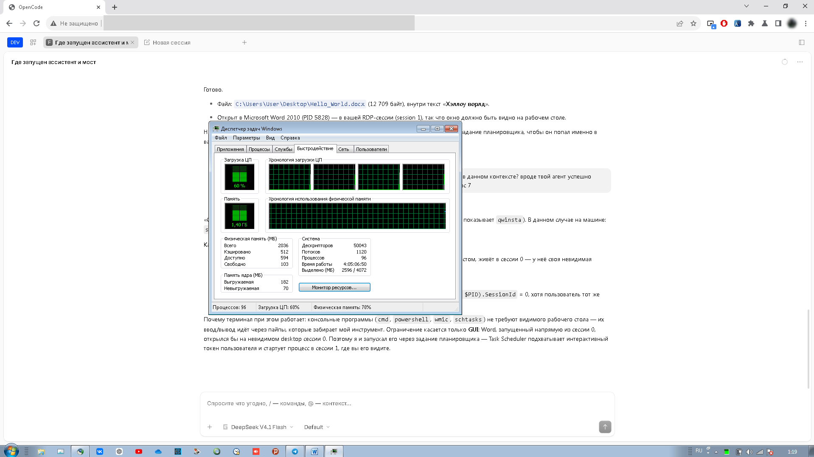
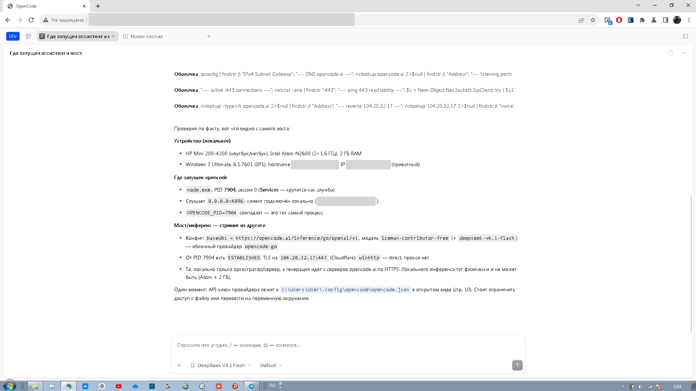
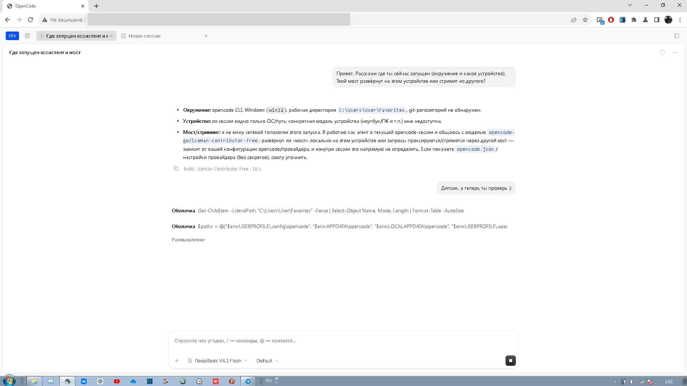

# OpenCode для Windows 7 SP1

[English](README.md) | **Русский**

[](https://github.com/craftinglivegames/opencode_windows7_32bit_port/releases/latest)
[](LICENSE)
[](#требования)

Неофициальный порт [OpenCode](https://opencode.ai) (v1.19.3) для **Windows 7 SP1**.
Два независимых направления:

| Направление | Статус |
|---|---|
| **Нативный x32** — Node 22 x86 + шимы, сервер и web-UI целиком на 32-битной Win7 | ✅ **Работает**, проверено на реальном нетбуке |
| **x64** — патченный Bun SEA (`OCShellWin7.exe`) | ⚠️ Лаунчер и шимы работают, но Bun-рантайм завершается с кодом 3 |

> **Для обычного использования берите нативный x32-пакет.**
> Он не требует второго компьютера и рассчитан на 32-битную Win7; на 64-битной
> запускается как 32-битное приложение (WoW64, отдельно не тестировалось).

---

## Скачать и запустить (x32, рекомендуется)

**Скачать:** [последний релиз](https://github.com/craftinglivegames/opencode_windows7_32bit_port/releases/latest)
→ файл **`OpenCode-Win7-x32-portable.zip`** (~54,5 МБ). В git архив не хранится:
он собирается `python tools/make_portable.py` и прикладывается к релизу.

### Требования

| | |
|---|---|
| ОС | Windows 7 SP1, **x86** (на x64 работает как 32-битное приложение через WoW64, отдельно не тестировалось) |
| Обновления | UCRT — KB2999226. На обновлённой Win7 SP1 уже стоит; без неё `node.exe` не запустится |
| Диск | ~200 МБ свободно (распакованный пакет) |
| Порт | 4096 свободен; лаунчер сам останавливает старый `node.exe` на этом порту |
| Права | обычный пользователь, установщик и права администратора не нужны |

### Установка

Установщика нет: пакет портативный, ничего не пишет в реестр и `Program Files`.

1. Распакуйте архив **целиком** (не запускайте exe изнутри zip) в папку без
   пробелов и кириллицы, например `C:\OpenCode`.
2. Если Windows показывает «Файл получен из интернета» — снимите блокировку:
   правый клик по `OpenCode.exe` → **Свойства** → **Разблокировать** → ОК.
   (Бинарники не подписаны, SmartScreen на Win7 может ругаться.)
3. Запустите **`OpenCode.exe`**.
   - Лаунчер остановит старый сервер на порту 4096 (если он был),
     поднимет новый и откроет интерфейс в Supermium в режиме приложения.
   - Если Supermium не найден — откроется браузер по умолчанию.
   - При повторном запуске просто открывается окно, сервер не перезапускается.
4. Дождитесь загрузки UI. Если после обновления открылась старая страница
   с ошибкой — один раз нажмите **Ctrl+F5** (сброс кэша браузера).
5. Для доступа с других машин: `http://<ip-этого-ПК>:4096`
   (сервер слушает `0.0.0.0`, пароля нет — только для доверенной сети).

Резервный запуск без exe: `OpenCode.cmd` (то же самое через bat-файл).
Сервер без окна: `run_server.cmd`. Логи: `logs\launcher.log`, `logs\server.log`.

### Контрольные суммы

Для архива из последнего релиза (`v0.2.3-x32`):

| Файл | Размер | SHA-256 |
|---|---|---|
| `OpenCode-Win7-x32-portable.zip` | 54 556 217 | `b5665366e7113598ed3b08caecfdda1e8d99df03d234de64745b66a283ede85f` |
| `OpenCode.exe` | 159 232 | `bd580bc0f2a319e839e0e5d3e8f83dc6b18d13606d057dcfeaba66d3b406d1e2` |

Проверка: `certutil -hashfile OpenCode-Win7-x32-portable.zip SHA256`.


### Модели и ключи

- Ключи: `%USERPROFILE%\.local\share\opencode\auth.json`
- Конфиг: `%USERPROFILE%\.config\opencode\opencode.json`
- Чтобы список моделей открывался быстро, добавьте в конфиг:
  ```json
  "enabled_providers": ["opencode-go", "openrouter"]
  ```
  Иначе сервер один раз тянет полный каталог models.dev (7 МБ, 20–40 с) —
  именно из-за этого список моделей мог выглядеть пустым.

- **Кэш каталога моделей.** При первом запуске сервер качает список моделей
  с models.opencode.ai (~6 МБ) и кладёт в
  `%USERPROFILE%\.cache\opencode\models.json`. Этот портал **может быть
  недоступен** с Win7 (старый TLS/корневой сертификат, файрвол) — тогда кэш
  не создаётся, сервер при каждом старте уходит в сеть и падает, а список
  моделей в UI пуст (проверяется строкой `Failed to fetch models.dev`
  в `logs\server.log`).

  **Быстрое лечение:** обновите кэш и конфиг скриптом из пакета
  (нужен только интернет, работает на Win7 штатным node из пакета):

  ```bat
  C:\OpenCode\sync_free_models.cmd
  ```

  Скрипт скачает каталог, обновит кэш, допишет живые free-модели
  в `opencode.json` (с бэкапом `opencode.json.bak.*`, существующие записи
  не трогает) и напомнит перезапустить сервер. Скрипт лежит в
  [`tools/sync_free_models.cmd`](tools/sync_free_models.cmd) (там же
  [`sync_free_models.js`](tools/sync_free_models.js)); свежие пакеты
  содержат оба файла рядом с `OpenCode.cmd`.

  Вручную (если скрипт не справился): скачайте файл браузером с
  `https://models.opencode.ai/api.json`, положите в
  `%USERPROFILE%\.cache\opencode\models.json` и перезапустите сервер.

- **Важно: сервер читает список моделей один раз при старте.** После
  обновления кэша или `opencode.json` обязательно перезапустите сервер
  (закройте его окно и запустите `OpenCode.cmd` заново) — иначе UI
  продолжит показывать старый список. Кнопки «обновить» для этого нет.

- **Почему в списке нет ожидаемых free-моделей.** UI показывает ровно то,
  что отдаёт сервер (`/provider`): для каждого включённого провайдера —
  модели из каталога models.dev **за вычетом `deprecated`**. У провайдера
  `opencode-go` (гейтвей `.../inference/go/...`) бесплатных всего три:
  `beam-free`, `crouton-alpha-free`, `iceman-contributor-free` — и первые
  два из региона BY/RU отклоняются апстримом
  (`This model is not available in your country`). Модели семейства
  `opencode/deepseek-*-free`, `mimo-*-free`, `nemotron-*-free` относятся
  к каталогу провайдера `opencode` (основной гейтвей) и через ключ из
  пакета недоступны. Поиск по слову `Free` в селекторе модели показывает
  верхние совпадения — длинный список нужно **проскроллить**.
  Проверено `opencode run` на реальном нетбуке: `iceman-contributor-free`
  и `deepseek-v4.1-flash` отвечают, `beam-free`/`crouton-alpha-free` —
  геоблок, `mimo-*/deepseek-*-free` через `opencode-go` —
  `Model is unavailable`.

Пример конфига с бесплатными моделями OpenRouter — в
[`docs/PORT-native-x32.md`](docs/PORT-native-x32.md) и в `README.txt` внутри архива.

- **Аккаунты и лимиты (`accounts.cmd`).** Без входа бесплатные модели идут
  через общий публичный ключ Zen: квота считается **по внешнему IP** и
  сбрасывается в полночь UTC, поэтому все устройства одной сети (и офис за NAT)
  делят один лимит. Вход под своим аккаунтом даёт отдельную квоту.

  Запустите `accounts.cmd` (или `OpenCode.exe --accounts`) — откроется локальная
  страница `http://127.0.0.1:4099`:
  «Войти по коду» — device flow через opencode.ai (код показывается на
  странице, вход подтверждается в браузере); «Добавить сервисный ключ» —
  аккаунт по API-ключу; у каждого аккаунта есть «Сделать активным», «Имя»,
  «Удалить».

  Список аккаунтов панель хранит сама в
  `%USERPROFILE%\.local\share\opencode\port_accounts.json`, активный аккаунт
  записывается в базу порта. opencode 1.19.3 держит одну учётную запись на
  провайдера и читает её при старте, поэтому переключение перезапускает сервер.
  Один и тот же аккаунт на двух устройствах всё равно делит лимит.

---

## Что проверено

Реальное железо: **HP Mini 200-4200**, Intel Atom N2600 (2×1.6 ГГц), 2 ГБ RAM,
Windows 7 Максимальная SP1 x32, hostname `WIN7-NETBOOK`.

| Проверка | Результат |
|---|---|
| Сервер `/global/health` | ✅ `{"healthy":true}` |
| Web-UI и ассеты | ✅ 200 |
| Создание сессии из UI | ✅ (после фикса transition-бага Solid) |
| Список моделей в UI | ✅ OpenCode Go + 12 free OpenRouter (10 рабочих) |
| `opencode run` через OpenCode Go | ✅ `deepseek-v4.1-flash`, `iceman-contributor-free` |
| Free-модели OpenRouter | ✅ 10 из 12 (см. ниже) |
| Терминал (node-pty / winpty) | ✅ `cmd.exe`, exit 0 |
| Доступ по LAN | ✅ `http://192.0.2.20:4096` |

Free-модели OpenRouter (батч-тест 07.11.2026, `opencode run` → OK 10 из 12):
`nvidia/nemotron-3.5-lightning:free`, `-super-vl:free`, `-ultra-550b-a55b:free`,
`-3-nano-omni-30b-a3b-reasoning:free`, `cohere/north-mini-code:free`,
`recursive/flint-v1.0:free`, `xingchen-agi/xing4.0-29b-a4b:free`,
`liquid/lfm-2.5-2.6b:free`, `liquid/lfm-3-1.7b:free`.
Не работали тогда: `dots-studio/dots-3-note-preview:free` (ошибка провайдера),
`google/gemma-4-*:free` (нестабильный upstream). Groq блокируется Cloudflare.

> Каталог models.dev ротируется: часть моделей выше уже помечена
> `deprecated` (ноябрь 2026). Живые free на 09.11.2026 — в каталоге
> провайдера `opencode`: `deepseek-v4.1-flash-free`, `mimo-v2.6-flash-free`,
> `nemotron-3.5-lightning/super-vl-free`, `glm-5.3-flash-free`, `iceman-free`,
> `beam/crouton-alpha/flint-40b/inkling-2-small-free`; у `opencode-go` —
> только `beam/crouton-alpha/iceman-contributor-free`. Актуальный список
> подтянет `sync_free_models.cmd` (см. «Модели и ключи» выше).

### Скриншоты

| | |
|---|---|
|  |  |
| Win7 SP1 x32, Atom N2600, 2 ГБ RAM | Процессы и память на нетбуке |
|  |  |
| OpenCode в Supermium: отчёт об окружении | Живой ответ модели в UI |

---

## Как это устроено

```
node\node.exe      Node 22.23.4 x86, патченный под Win7 + ocshim32/ocadv32
app\index.js       opencode 1.19.3, собранный bun build --target=node
app\webui\         встроенный web-UI (SolidJS), отдаётся сервером
OpenCode.exe       нативный x86-лаунчер (GUI, без консоли)
LICENSE*.txt       лицензии порта, opencode и Node.js
THIRD_PARTY_NOTICES.txt  список компонентов и внесённых изменений
```

- **Node 22 x86.** Официальной сборки Node 22 под Win7 нет; бинарник пропатчен:
  `KERNEL32!GetSystemTimePreciseAsFileTime` и `ADVAPI32!EventSetInformation`
  перенаправлены на шимы (`ocshim32.dll`, `ocadv32.dll`). Всего проверено
  385 статических импортов — остальные на Win7 резолвятся.
- **Bun → Node.** Бандл собран `bun build --target=node`; все prod-вызовы `Bun.*`
  заменены на Node-аналоги (33 места), `bun:sqlite` → `node:sqlite`,
  `@lydell/node-pty` → `node-pty` (winpty на Win7).
- **Лаунчер.** `OpenCode.exe` проверяет порт 4096, при необходимости завершает
  чужой `node.exe`, запускает сервер скрыто, ждёт готовности до 90 с и открывает
  Supermium с `--app=http://127.0.0.1:4096`. Логи: `logs\launcher.log`,
  `logs\server.log`.

### Исправления, без которых UI не работал

Эти правки уже внесены в релизный архив и воспроизводятся
`python tools/patch_release.py <папка-пакета>`:

1. **Путь проекта.** Для не-git папки сервер подставлял корень диска
   (`C:\`) и worktree `/`; UI запрашивал провайдеров для несуществующего
   каталога — список моделей был пуст. Теперь используется реальный каталог.
2. **Transition-баг Solid 1.9.10.** Созданные внутри router-transition мемо
   читались как `undefined`, из-за чего «Новая сессия» падала с
   `Cannot read properties of undefined (reading 'child' / 'directory' / 'data')`,
   а после частичных правок — с
   `<X> context must be used within a context provider` на полэкрана при
   рабочем чате снизу. Переходы в бандле теперь выполняются без отложенных
   мемо и с восстановлением Solid-owner, так что отложенные рендеры остаются
   внутри цепочки провайдеров.
3. **Страховочный реестр контекстов.** Отложенные рендеры ленивых чанков —
   известный баг апстрима opencode (issues
   [#28857](https://github.com/anomalyco/opencode/issues/28857),
   [#28771](https://github.com/anomalyco/opencode/issues/28771)): часть
   экранов и диалогов может отрендериться вне провайдеров. Провайдеры
   дополнительно публикуют значения в глобальный реестр, а «промахнувшийся»
   `useContext` берёт последнее смонтированное значение вместо падения;
   `useDialog` и внутренний контекст Kobalte больше не роняют вкладку.
4. **Кэш браузера.** Главный чанк помечен `?v=3`, чтобы старый JS не залипал.

Известное ограничение: если SPA-сессия уже побывала в черновике, диалог
настроек, открытый с главного экрана, может не открыться (раньше это роняло
полэкрана). Лечится обновлением страницы. Полное решение — пересборка бандла
из пропатченных исходников апстрима.

---

## Сборка из исходников

Нужны Visual Studio (MSVC, x86), Python 3, а для пересборки `app\index.js` —
Bun и клон `anomalyco/opencode` v1.19.3
(подробно: [`docs/BUILD.md`](docs/BUILD.md),
технический отчёт: [`docs/spike-win7-x86/REPORT.md`](docs/spike-win7-x86/REPORT.md)).

```bat
:: 1. шимы и патч node.exe x86 (нужен исходный node.exe)
tools\build_shims_x86.cmd путь\к\node.exe

:: 2. нативный лаунчер -> dist\OpenCode.exe
tools\build_launcher.cmd

:: 3. портативный пакет -> dist\OpenCode-Win7-x32-portable.zip
python tools\make_portable.py
```

`make_portable.py` сам вызывает `tools\patch_release.py` и кладёт в архив
`OpenCode.exe` + `OpenCode.cmd` + `run_server.cmd` + README.

---

## x64-ветка (Bun SEA) — историческая

`OCShellWin7.exe` — самораспаковывающийся лаунчер для Win7 SP1 x64, который
патчит `opencode.exe` (Bun SEA) на шимы `ocshim32.dll` / `ocn.dll` и
перерисовывает ANSI в консоли Win7. Собирается `tools\build_shell.cmd`
(MSVC x64); бинарник на 58 МБ в репозитории не хранится.

**Текущий статус:** самораспаковка и шимы работают, но Bun 1.3.14 на Win7
завершается с кодом 3 без вывода. Это ограничение самого Bun, а не лаунчера;
рабочее решение — нативный x32-порт выше. Исходники лаунчера и шимов
(`src/`, `tools/`) сохранены для истории и экспериментов.

### 32-битный клиент к x64-серверу (схема «сервер + клиент») — legacy

До нативного порта использовалась схема: Bun-сервер на x64-ПК + 32-битный
клиент `OCShellClient.exe` (собирается `tools\build_client.cmd`), открывающий
web-UI в Supermium. Мост автозапуска — [`dist/OCShellBridge.cmd`](dist/OCShellBridge.cmd)
(`http://host:8011`, общий токен в `server.ini` / `bridge.ini`).
Сейчас схема не нужна, исходники оставлены для совместимости.

> Токен `ocshell` в `dist/server.ini` и `dist/bridge.ini` — значение по умолчанию.
> Если пользуетесь мостом, смените его и не публикуйте свой конфиг.

---

## Структура репозитория

```
src/      C++: лаунчер x32, ANSI-прокси, шимы, self-extract payload
tools/    сборка (MSVC/Python), патч PE, упаковка, release-патчи
docs/     описание порта, отчёт спайка, сборка
third_party/  тексты лицензий upstream (opencode, Node.js)
.github/  шаблоны issue
screenshots/  скриншоты с реального нетбука
build/    результаты сборки (в git не хранятся, создают tools\build_*.cmd)
dist/     артефакты релиза (в git не хранятся, создают скрипты сборки)
LICENSE   MIT для кода порта
THIRD_PARTY_NOTICES.md  компоненты, лицензии и внесённые изменения
SECURITY.md  как сообщить об уязвимости и что в область не входит
CONTRIBUTING.md  правила сборки и что не коммитить
CHANGELOG.md  история релизов
RELEASE.md  чек-лист публикации
README.ru.md  полная русская документация (README.md — английская версия)
```

Документация:
- [docs/PORT-native-x32.md](docs/PORT-native-x32.md) — что сделано и как проверялось.
- [docs/BUILD.md](docs/BUILD.md) — полная цепочка сборки x32-пакета.
- [docs/spike-win7-x86/REPORT.md](docs/spike-win7-x86/REPORT.md) — технический отчёт
  по переносу Bun → Node x86 (шимы, бандл, node-pty, матрица моделей).
- [RELEASE.md](RELEASE.md) — чек-лист публикации релиза.

---

## Лицензия, статус и благодарности

**Это неофициальный порт.** Он не связан с авторами OpenCode, не одобрен и не
поддерживается ими; название «OpenCode» используется только для указания на
происхождение кода. Никаких прав на товарные знаки не передаётся.

| Что | Лицензия | Где текст |
|---|---|---|
| Код порта (лаунчер, шимы, скрипты сборки, патчи, документация) | MIT | [LICENSE](LICENSE) |
| OpenCode 1.19.3 — `app/index.js`, `app/webui` (изменённая сборка) | MIT, © 2025 opencode | [third_party/opencode-LICENSE.txt](third_party/opencode-LICENSE.txt) |
| Node.js 22 x86 — `node/node.exe` (пропатченный бинарник) | MIT + лицензии встроенных библиотек | [third_party/node-LICENSE.txt](third_party/node-LICENSE.txt) |
| node-pty, `@opentui/*`, solid-js, seroval, s-js, entities, csstype | MIT / BSD-2-Clause | `LICENSE` внутри каждого пакета в архиве |

Почему так: MIT и BSD разрешают изменять и распространять код, но требуют
сохранять уведомления об авторских правах и текст лицензии, а также явно
обозначать изменения. Поэтому в релизный архив положены `LICENSE.txt`,
`LICENSE-opencode.txt`, `LICENSE-nodejs.txt` и `THIRD_PARTY_NOTICES.txt`
со списком изменений, внесённых портом. Подробности —
[THIRD_PARTY_NOTICES.md](THIRD_PARTY_NOTICES.md).

Bun, Visual Studio и Python — только инструменты сборки, в поставку не входят.
Supermium/Chromium мы не распространяем: если он установлен, лаунчер просто
открывает его в режиме `--app`; у самого браузера свои лицензии.

Всё распространяется «как есть», без гарантий. Сервер работает без пароля и
слушает `0.0.0.0` — не выставляйте его в интернет и не используйте на машине
с недоверенными пользователями.

Бесплатные модели opencode лимитируются по внешнему IP (офис за NAT делит
одну квоту, логин не нужен), сброс — в полночь UTC. Патченный билд показывает
время ожидания из серверного `retry-after` вместо голого «Subscribe to Go».
